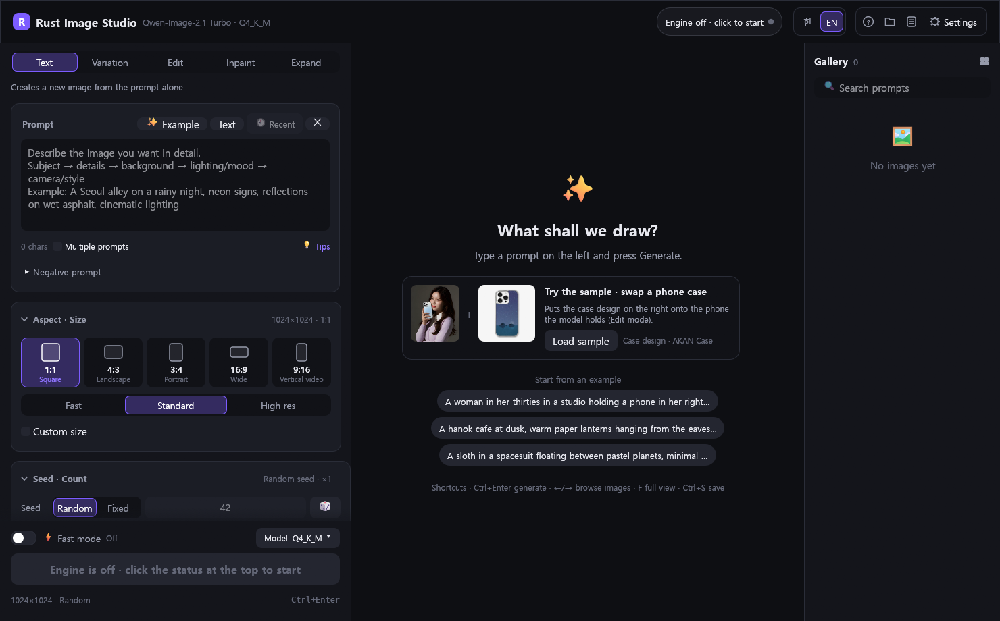
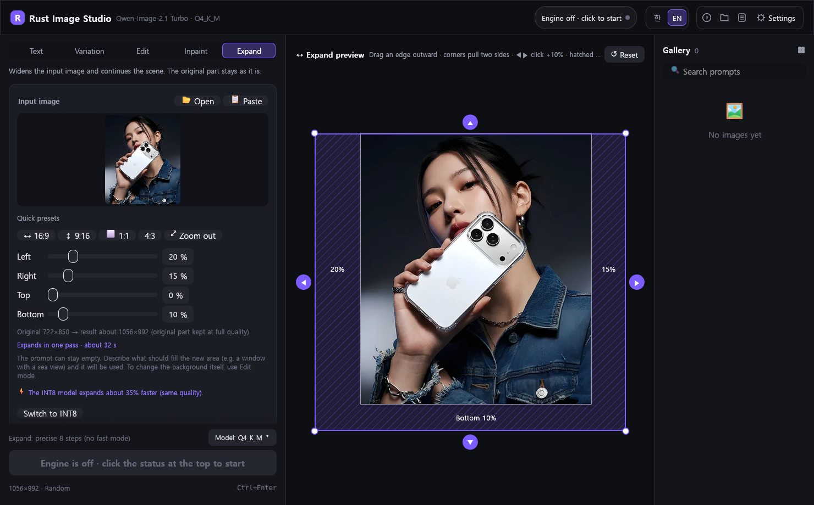

<div align="center">


# Rust Image Studio

**Qwen-Image-2.1을 내 PC에서 실행하는 Rust 네이티브 AI 이미지 스튜디오**<br>
텍스트 투 이미지 · 이미지 변형 · 지시문 편집 · 인페인팅 · *원본 보존형 아웃페인팅*<br>
Qwen-Image-2.1 Turbo · 완전 오프라인 추론 · 계정·구독·클라우드 의존성 없음


[English](README.md) · **한국어**

### ⚡ Qwen-Image-2.1, 8GB VRAM에서도 매끄럽게 · 4~6GB에서도 동작
RTX 3060 Ti 8GB 기준 1024×1024 한 장 **약 10~19초** · 4~6GB 카드는 자동 저VRAM 모드 · AMD 라데온 실험적 지원 · 고사양 GPU·클라우드 없이 로컬에서 동작

[-0078d4?style=for-the-badge&logo=windows&logoColor=white)](../../releases/latest/download/RustImageStudio-windows-x64.zip)
[-fcc624?style=for-the-badge&logo=linux&logoColor=black)](../../releases/latest/download/RustImageStudio-linux-x64.tar.gz)

**사전 빌드 바이너리 제공** · 압축 해제 후 `RustImageStudio.exe` 실행만으로 바로 사용할 수 있습니다.<br>
엔진·모델은 최초 실행 시 자동 프로비저닝 · 전체 UI 레퍼런스: **[메뉴 가이드](docs/GUIDE.ko.md)**



</div>

## 핵심 특징

<table>
<tr>
<td width="25%" valign="top">

### ⚡ 8GB 고속 추론
RTX 3060 Ti 8GB 기준 1024×1024 **약 10~19초**. VRAM 6GB 한도의 고정 메모리 배치에 모델 상주·예열을 더해 반복 생성 지연을 최소화하고, INT8 텐서코어 경로를 지원합니다. VRAM 4~6GB 카드는 더 작은 한도와 타일 디코딩으로 자동 전환됩니다([표](#windows)).

</td>
<td width="25%" valign="top">

### 📦 제로 설정 배포
런타임 의존성이 없는 단일 실행 파일(26MB). 최초 실행 시 엔진·모델·LoRA를 이어받기 방식으로 자동 프로비저닝합니다. Python, ComfyUI, 노드 그래프가 필요 없습니다.

</td>
<td width="25%" valign="top">

### 🖼️ 원본 보존 확장
가장자리를 드래그해 캔버스를 확장합니다(아웃페인팅). 원본 픽셀은 원 해상도 그대로 재합성하고, 대규모 확장은 다단계 패스로 분할하며, 공백 생성 결과는 자동으로 감지해 재생성합니다.

</td>
<td width="25%" valign="top">

### 🦀 네이티브 Rust
Electron·웹뷰 없는 즉시 모드 GPU UI(egui). 상태 변화가 없으면 리페인트하지 않으며, 이미지 엔진과 캡셔닝 엔진의 GPU 작업을 순차 스케줄링해 VRAM 경합을 방지합니다.

</td>
</tr>
</table>

## Claude AI 기반 개발

Rust의 장점을 극대화하기 위해, 본 프로젝트는 Anthropic의 **Claude AI**(Claude Code)를 개발 과정에 적극 활용했습니다.

- **메모리 안전성과 동시성** — 소유권·차용 규칙에 맞춘 구조를 Claude와 함께 설계해, 다운로드·이미지 디코딩·엔진 통신을 UI 스레드와 분리된 백그라운드에서 데이터 경합 없이 처리합니다.
- **제로 코스트 추상화와 네이티브 성능** — 가비지 컬렉터와 별도 런타임이 없는 단일 바이너리, 상태가 바뀔 때만 리페인트하는 즉시 모드 GPU UI로 리소스 사용을 최소화했습니다.
- **단일 코드베이스 크로스 플랫폼** — OS별 코드를 조건부 컴파일(`cfg`)로 분리해 하나의 소스로 Windows와 Linux를 지원합니다.
- **검증 중심 개발** — Claude와 함께 진행한 주요 변경 사항은 단위 테스트, 실제 GPU에서의 생성 시간 측정, 앱 화면 캡처 기반 UI 점검으로 검증했습니다.

## 활용 사례 · 폰케이스 디자인 교체

입력은 이미지 두 장과 지시문 한 줄입니다. 모델 사진을 참조 1, 케이스 디자인을 참조 2로 지정하고 편집 모드로 생성하면 포즈·손·얼굴·조명은 그대로 유지한 채 케이스 디자인만 교체됩니다. 해당 샘플은 앱에 내장되어 있어 시작 화면의 **샘플 불러오기**로 즉시 재현할 수 있습니다.

<p align="center"></p>

> *"1번 이미지 속 휴대폰의 케이스를 2번 이미지의 케이스 디자인과 똑같이 바꿔줘. 인물, 자세, 배경은 그대로 유지해."*

샘플 디자인 제공 · **[AKAN](https://akan.co.kr/?utm_source=github&utm_medium=readme&utm_campaign=rust-image-studio)**<br>
Rust Image Studio는 AKAN이 제품 비주얼 제작을 위해 구축한 인하우스 툴에서 출발했으며, 더 많은 크리에이터와 개발자가 활용할 수 있도록 오픈소스로 공개되었습니다.

## 빠른 시작
### Windows
**시스템 요구 사항:** Windows 10/11 x64 · **VRAM 8GB 이상 권장** NVIDIA GPU(4~6GB는 자동 저VRAM 모드로 동작, 아래 참고 · 최신 드라이버, AMD Radeon은 [실험적](#amd-radeon-실험적)) · RAM 16GB · 여유 디스크 약 15GB · 최초 실행 시 인터넷 연결. 별도 설치 과정은 없습니다. 실행 파일 하나로 기동하며 나머지 구성 요소는 최초 실행 시 자동으로 내려받습니다. 단, 그래픽 드라이버는 애플리케이션이 설치할 수 없으므로 미검출 시 화면에 안내합니다.

**VRAM 4~6GB 그래픽카드**는 자동으로 저VRAM 모드로 동작합니다(8GB 이상은 기존 설정 그대로).

| VRAM | VRAM 한도 | VAE 디코딩 | 모델 (이미지 · 텍스트 인코더) | 1024×1024 실측* |
|---|---|---|---|---|
| 8GB 이상 | 6GB | 일반 | Q4_K_M · UD-Q4_K_XL | 약 18초 |
| 6GB (GTX 1660 Ti, RTX 2060, 노트북 RTX 3060/4050) | 4GB | 512² 타일 | Q4_K_M · UD-Q4_K_XL | 약 26초 |
| 4GB (노트북 RTX 3050, GTX 1650) | 3GB | 512² 타일 | Q4_K_M (RAM 13GB 미만이면 **Q3_K_S**) · **Q3_K_S** | 약 28초 |

\*RTX 3060 Ti에서 나머지 VRAM을 다른 프로그램으로 점유해 6GB·4GB 카드의 여유 공간만 남기고 잰 값입니다. 계산이 느린 카드는 그만큼 더 걸립니다.

- **GeForce GTX 카드**(GTX 16 시리즈 이하)는 텐서코어가 없어 연산 속도가 병목입니다. GTX 1650에서 1024×1024 한 장에 500초 넘게 걸렸습니다. 그래서 '빠름' 크기(736×736)와 Lightning 4단계 LoRA로 시작하며(연산량 약 1/4), INT8 모델은 숨깁니다.
- **4GB 카드**는 더 작은 텍스트 인코더(Qwen3-VL-8B Q3_K_S, 5.15GB 대신 3.77GB)를 받습니다. RAM이 13GB 미만인 PC라면 이미지 생성 모델도 Q3_K_S(4.2GB 대신 2.72GB)를 씁니다. 단계당 24% 느리지만 RAM을 1.5GB 덜 써서 엔진이 가상메모리로 밀려나지 않습니다.
- 확장·변형·부분 수정은 항상 일반 8단계로 생성합니다. Lightning 4단계로 확장하면 테두리가 비거나 대상이 두 번 그려졌습니다.
- **여유 RAM이 부족하면** 엔진 시작 시 모델을 모두 RAM에 올리지 않고 텍스트 인코더를 디스크에서 읽습니다(새 프롬프트마다 몇 초 더). Windows가 엔진을 가상메모리로 밀어내 멈추는 것을 막습니다.

1. [`RustImageStudio-windows-x64.zip`](../../releases/latest/download/RustImageStudio-windows-x64.zip)(사전 빌드 바이너리, 약 10MB · 이전 버전은 [Releases](../../releases))을 내려받아 빈 폴더에 압축을 해제합니다.
2. `RustImageStudio.exe`를 실행합니다. Rust 툴체인·Visual Studio·소스 빌드는 필요하지 않습니다([직접 빌드](#빌드) 시에만 해당).
3. 최초 실행 시 필요한 구성 요소를 **자동으로** 프로비저닝합니다(약 12.7GB, 중단 시 다음 실행에서 이어받기).
   - 필수: Visual C++ 런타임(미설치 시에만, UAC 확인 1회) · 추론 엔진(stable-diffusion.cpp CUDA 12, AMD에서는 ROCm 또는 Vulkan 빌드) · CUDA 런타임(NVIDIA 전용) · 이미지 모델 · 텍스트 인코더 · VAE
   - 선택: 비전 모듈(편집·확장·사진 설명) · 추천 LoRA 3종 · 캡셔닝 엔진(llama.cpp Vulkan)
   - 선택 구성 요소 다운로드에 실패해도 기본 생성 기능은 즉시 사용할 수 있으며, 시작 전 디스크 여유 공간을 사전 검증합니다.

처음 실행하면 영어 UI로 시작하며, 상단 바의 **한 | EN** 토글로 한국어 UI로 전환할 수 있습니다(설정에 영구 저장).

### 디렉터리 구조
`runtime`과 `models`는 최초 실행 시 자동으로 구성되며, 수동으로 배치해도 무방합니다.

```
RustImageStudio.exe
runtime/   sd-server.exe, stable-diffusion.dll, ggml-cuda.dll, cudart/cublas DLL
           llama/  (선택: 사진 자동 설명용 llama.cpp Vulkan 빌드)
           rocm/, vulkan/  (AMD Radeon 등에서 쓰는 엔진 빌드, 해당할 때만)
models/    qwen-image-2.1-turbo-Q4_K_M.gguf
           Qwen3-VL-8B-Instruct-UD-Q4_K_XL.gguf
           qwen_image_2.1_vae_bf16.safetensors
           mmproj-Qwen3-VL-8B-F16.gguf   (선택: 이미지 편집 모드용 비전 모듈)
outputs/   생성 이미지 + history.json (자동 생성)
```

## AMD Radeon (실험적)

stable-diffusion.cpp가 같은 태그(`master-1052-f5df5f8`)로 배포하는 **공식** AMD 빌드를 사용합니다. CUDA 변환 계층(ZLUDA 등)은
쓰지 않습니다. 그래픽카드를 감지해 엔진 빌드를 자동으로 고르며, **설정 → GPU**(자동 · NVIDIA CUDA · AMD ROCm · Vulkan)에서
직접 지정할 수 있습니다. 빌드마다 폴더가 분리되어(`runtime\` = CUDA, `runtime\rocm\`, `runtime\vulkan\`) 전환해도 다시 받지 않습니다.

| 감지된 GPU | 자동 선택 엔진 | 다운로드 |
|---|---|---|
| NVIDIA (드라이버 있음) | CUDA 12 + CUDA 런타임 (기존과 동일) | 363MB + 563MB |
| AMD Radeon RX 6000 / 7000 / 9000, Radeon PRO W6000–W9000, Radeon 8060S/8050S/8040S (Windows) | ROCm/HIP. zip에 HIP 런타임 DLL이 포함되어 AMD Adrenalin 드라이버만 있으면 됩니다 | 266MB |
| 그 밖의 AMD Radeon (RX 5000 이하, 대부분의 내장 Radeon 그래픽) | Vulkan | 30MB |
| Linux AMD + `/dev/kfd` + 지원 `gfx` 타깃 + ROCm 7 설치(`libamdhip64.so.7`, `libhipblas.so.3`, `librocblas.so.5`) | ROCm (Ubuntu 24.04 빌드, glibc 2.38 이상) | 298MB |
| 그 밖의 Linux AMD | Vulkan (업스트림이 Ubuntu 26.04에서 빌드: **glibc 2.43 이상** 필요) | 42MB |

엔진이 쓸 장치 이름(`ROCm0`, `Vulkan0`)은 `sd-server --list-devices` 출력에서 읽으며, 메모리 배치는 NVIDIA와 동일합니다(가중치 RAM
사본, VRAM 6GB 한도, 8GB 미만 카드는 더 낮게). CUDA가 아니면 **INT8 텐서코어 모델**은 쓸 수 없습니다(CUDA 빌드의 CUTLASS INT8
커널 필요). 이 경우 Q4_K_M을 사용하고 해당 선택지를 숨깁니다. ⚡ 빠른 모드와 모든 생성 모드는 그대로 사용할 수 있으며, 사진 설명
엔진은 원래 Vulkan 빌드라 AMD 드라이버에서도 동작합니다.

**검증 현황.** 투명하게 밝히면, **실제 AMD 하드웨어에서는 아직 한 번도 실행해 보지 않았습니다.** 개발 PC에는 RTX 3060 Ti만 있습니다.

| 검증 완료 | 환경 |
|---|---|
| GPU 감지, 엔진 선택, 장치 이름 파싱, Linux ROCm zip의 `build/bin/` 구조 처리, VRAM 한도 계산: 단위 테스트 | Windows |
| NVIDIA 경로 무변경: 여전히 `CUDA0`·CUDA 런타임 다운로드, 1024×1024 18.3초/19.5초, 전체 테스트 통과 | Windows, RTX 3060 Ti |
| AMD zip 4종의 구성·의존성(Windows는 HIP DLL 포함, Linux ROCm은 시스템 ROCm 7 링크, Linux Vulkan은 glibc 2.43 필요) | 배포 아카이브 직접 분석 |
| **앱에서 Vulkan 엔진 경로 전체 동작**: 장치 `Vulkan0` 인식, Q4_K_M 1024×1024 21.5초(새 프롬프트)/19.1초(반복), ⚡ 빠른 모드 15.1–15.8초. 최초 실행 예열 83초(셰이더 컴파일), 이후 22초 | Windows, 업스트림 Vulkan zip을 **RTX 3060 Ti**에서 실행(AMD가 아닌 NVIDIA Vulkan 드라이버) |
| 로컬 미러로 Vulkan 엔진 최초 설치: 목록에 CUDA 런타임 없음, `runtime\vulkan\`에 압축 해제, 설치 화면의 GPU 안내·다운로드 실패 표시 | Windows |

| 미검증 | 이유 |
|---|---|
| AMD Radeon에서의 실제 생성(ROCm·Vulkan 모두), 속도와 VRAM 동작 | AMD GPU 없음 |
| Windows ROCm 빌드와 Adrenalin 드라이버 버전의 호환성, RX 6000/7000/9000 이름 기반 자동 선택 기준 | AMD 하드웨어 필요 |
| 실제 ROCm 7이 설치된 Linux의 ROCm 엔진, Ubuntu 26.04에서의 Linux Vulkan 엔진 | AMD 하드웨어 / 26.04 환경 필요 |

선택한 엔진이 GPU를 찾지 못하면 앱이 이를 알리고 설정 → GPU에서 다른 방식(예: ROCm 대신 Vulkan)을 고르도록 안내합니다.
Radeon 사용자분들의 결과 공유(카드, 드라이버, 엔진 종류, 장당 시간 또는 엔진 로그)를 환영합니다.

## Linux (실험적)

배포 모델은 Windows와 동일합니다. 단일 실행 파일만으로 최초 실행 시 나머지 구성 요소를 모두 프로비저닝합니다. stable-diffusion.cpp가 Linux용 CUDA 빌드를 배포하지 않으므로
본 저장소에서 직접 빌드합니다(`scripts/build-linux-engine.sh`, [`linux-engine`](.github/workflows/linux-engine.yml) 워크플로.
업스트림 Windows CUDA 빌드와 동일한 태그·빌드 옵션, CUDA 12.8, Pascal~Blackwell GPU 아키텍처 대상). 빌드 산출물은 CUDA 런타임 라이브러리와 함께
릴리스 `engine-sd-master-1052-f5df5f8`로 게시합니다.

> **Linux 엔진 릴리스:** 앱은 본 저장소의 `engine-sd-master-1052-f5df5f8` 릴리스에서 엔진을 내려받으며, 이 릴리스는 `linux-engine`
> 워크플로를 1회 실행해 게시합니다. 게시 전까지는 엔진 다운로드가 실패하며, 설치 화면이 대신 수동 빌드 명령을 제시합니다.

**시스템 요구 사항:** x86_64 Linux, glibc 2.35 이상(Ubuntu 22.04·Debian 12 이상) · **VRAM 8GB 이상 권장** NVIDIA GPU(4~6GB는 저VRAM 모드) + 독점 드라이버(525 이상,
미검출 시 설치 화면에서 안내) · RAM 16GB · 여유 디스크 약 17GB · X11 또는 Wayland 데스크톱 세션

| 최초 실행 시 프로비저닝 항목 | 크기 | 출처 |
|---|---|---|
| 추론 엔진: stable-diffusion.cpp CUDA 12 (Linux 빌드) | 약 360MB(추정) | 본 저장소 엔진 릴리스 |
| CUDA 런타임(cudart, cuBLAS) | 594MB | 본 저장소 엔진 릴리스 |
| 모델·선택 구성 요소·LoRA | Windows와 동일 | Hugging Face |
| *선택:* 캡셔닝 엔진 llama.cpp `b12182` Ubuntu Vulkan | 36MB | GitHub (ggml-org/llama.cpp) |

자동 프로비저닝 범위 밖의 시스템 라이브러리는 배포판 패키지로 제공됩니다. 대부분의 데스크톱 환경에는 이미 설치되어 있습니다:

```bash
sudo apt install libxkbcommon0 libxkbcommon-x11-0 libwayland-client0 libx11-6 libxcursor1 libxrandr2 libxi6 libvulkan1 libgl1 libegl1 xdg-desktop-portal
```

설치 화면은 검증 가능한 항목(NVIDIA 드라이버, glibc, `libstdc++`, 캡셔닝용 `libvulkan`)을 사전 점검하고 필요한 패키지명을 제시합니다.
X11 세션에서 `libxkbcommon-x11-0`이 없으면 창 생성 전에 프로세스가 종료됩니다. 파일 대화상자는 `xdg-desktop-portal`과 GTK·GNOME·KDE 백엔드를
통해 제공됩니다. 한글 폰트(나눔고딕)와 아이콘 폰트는 바이너리에 내장되어 있습니다. 창이 표시되지 않으면 `WGPU_BACKEND=vulkan ./RustImageStudio`(또는 `=gl`)로 렌더링 백엔드를 지정하십시오.

1. [`RustImageStudio-linux-x64.tar.gz`](../../releases/latest/download/RustImageStudio-linux-x64.tar.gz)(사전 빌드 바이너리 · 이전 버전은 [Releases](../../releases))를 내려받아 압축을 해제합니다: `tar xzf RustImageStudio-linux-x64.tar.gz`
2. `./RustImageStudio/RustImageStudio`를 실행합니다. 최초 실행 시 엔진, CUDA 런타임, 모델, 선택 구성 요소를 이어받기 방식으로 프로비저닝한 뒤 엔진을 기동합니다.

설정은 `~/.local/share/rustimagestudio`에 저장됩니다. `runtime/` 또는 `PATH`에 직접 빌드한 `sd-server`가 있으면 다운로드 대신 해당 바이너리를 우선 사용합니다.

**Linux 검증 현황.** 투명하게 공개합니다. 본 포팅은 아직 **실제(비 WSL) Linux 데스크톱 환경에서 검증되지 않았으며**,
**Linux 엔진 릴리스는 CI로 빌드·게시된 이력이 없습니다.** 아래 엔진은 로컬 빌드 산출물입니다.

| 검증 완료 | 환경 |
|---|---|
| `cargo check`, `cargo test`(26개), `cargo build --release` 경고 없이 통과. 바이너리는 glibc·libgcc_s에만 동적 링크 | WSL2 Ubuntu 24.04, `-dev` 패키지 미설치 |
| `.tar.gz` 추출: 최상위 폴더 제거, 심볼릭 링크, 실행 권한, 경로 탐색(path traversal) 차단 | 단위 테스트(Linux·Windows) |
| `scripts/build-linux-engine.sh`를 CUDA 12.8로 실행해 두 아카이브까지 빌드·패키징. 아카이브 외부 런타임 의존성은 glibc, `libstdc++`, `libgcc`, 드라이버의 `libcuda.so.1`뿐 | WSL2, 단일 GPU 아키텍처(sm_86) 빌드로 엔진 아카이브 68MB(전체 빌드 대비 축소) |
| 로컬 미러 기반 최초 실행 E2E: 해당 엔진, CUDA 런타임, 실제 llama.cpp `b12182` 아카이브 다운로드·추출(실행 권한 설정, `RUNPATH=$ORIGIN`으로 `sd-server` 인접 CUDA 라이브러리 로드) | WSL2 |
| 앱이 해당 엔진을 RTX 3060 Ti에서 기동해 1024×1024 생성(24초). 동일 빌드 `sd-cli`로 512×512 생성 | WSL2(Windows 드라이버 경유 CUDA) |
| 앱 종료 시 엔진 프로세스 동반 종료, `kill -9` 강제 종료 시에도 동일(`PR_SET_PDEATHSIG`) | WSL2 |
| 앱 창, 설치 화면, 메인 화면의 영어·한국어 렌더링. 내장 한글·아이콘 폰트(글리프 누락 없음) | WSLg(Wayland, `WGPU_BACKEND=vulkan` 필요) |

| 미검증 | 사유 |
|---|---|
| GitHub에서 `linux-engine` 워크플로 실행(9개 아키텍처, 수 시간 소요), 산출물의 glibc 하한(24.04 로컬 빌드는 2.38 요구, 워크플로는 2.35 호환을 위해 22.04에서 빌드), 게시된 엔진 아카이브의 실제 크기 | 워크플로 미실행 |
| 설치 화면의 NVIDIA 드라이버·glibc·libvulkan 안내 | Linux 타깃 컴파일만 확인, 해당 구성 요소가 없는 환경에서는 미확인 |
| Linux NVIDIA Vulkan 드라이버에서의 캡셔닝 실행 | 네이티브 드라이버 필요 |
| 실제 GNOME/KDE 환경의 파일 대화상자, 클립보드, 휴지통, "폴더에서 보기" | WSLg에 데스크톱 포털·파일 관리자 부재 |
| Linux 성능(본 문서의 수치는 모두 Windows 실측값) | WSL2 수치는 대표성 없음 |

WSLg 알려진 이슈: 간헐적으로(엔진 로딩 중 관측) 창이 640×480으로 생성되고 WSLg가 리사이즈 요청을 무시합니다. 창을 수동으로
확대하십시오. Windows에서는 발생하지 않으며, 일반 Linux 데스크톱에서는 미확인입니다.

실제 Linux 환경에서의 사용 결과를 공유해 주시면 큰 도움이 됩니다.

## 생성 모드
모든 버튼·메뉴·옵션의 상세 설명은 **[메뉴 가이드](docs/GUIDE.ko.md)**를 참고하십시오.

- **텍스트 투 이미지**: 프롬프트만으로 신규 이미지 생성
- **이미지 변형(img2img)**: 입력 이미지를 기반으로 재생성. 강도 0.1~1.0, 8단계 중 ceil(8×강도) 단계만 실행
- **지시문 편집**: 자연어 지시로 참조 이미지(최대 3장)를 편집. 비전 모듈 필요(앱 내에서 다운로드 가능)
- **인페인팅**: 브러시로 지정한 마스크 영역만 재생성
- **아웃페인팅(확장)**: 캔버스 외곽을 확장해 장면을 연속 생성. 아래 상세 설명 참고

입력 이미지는 드래그 앤 드롭, Ctrl+V 붙여넣기, 열기 버튼, 갤러리 우클릭 → "입력 이미지로 사용"으로 지정할 수 있습니다.

## 아웃페인팅 파이프라인

<p align="center"></p>



비전 모듈이 있으면 **참조 유도(reference-guided) 방식**을 사용합니다(동일 이미지·시드 조건에서 기존 방식과 비교 평가 후 채택).
1. 확장 캔버스에 원본을 배치하고 신규 영역을 회색으로 채운 이미지를 **편집 참조**로 모델에 제공
2. 신규 영역(+원본 경계 3%)만 마스크로 지정해 처음부터 생성 → 원본 영역의 위치 편차 없음
3. 결과를 최대 1.6배 업스케일한 뒤 **원본을 원 해상도 그대로** 페더링 경계로 재합성

- 1~2방향 확장은 면적 3배까지 단일 패스로 처리하며(1:1→16:9 약 30초), 사방 줌아웃은 면적 약 2배씩 다단계로 분할합니다.
  사방 2배 줌아웃을 단일 패스로 처리하면 테두리가 평탄하게 비거나 번지는 현상이 있었고, 2단계로 분할하면 깨끗했습니다.
- 일부 시드에서 모델이 회색 플레이스홀더를 그대로 복제하거나(회색·보라 단색 영역, 흐린 칸막이) 비워 두는 실패 모드가 있습니다.
  이에 신규 영역의 공백을 자동 감지해 다른 시드로 재생성합니다(최대 2회).
  감지 알고리즘은 테스트 샘플 28장(실패 8, 성공 20)을 모두 정확히 분류했으며, 민무늬 벽·흰 스튜디오 배경은 실패로 오판하지 않습니다.
- 확장 모드에 이미지를 투입하면 프롬프트를 자동 생성합니다. 본 앱이 생성한 PNG는 메타데이터에 저장된 장면 설명을 즉시 재사용하고,
  일반 사진은 `runtime/llama/llama-mtmd-cli.exe`(Linux: `llama-mtmd-cli`, llama.cpp b12182 Vulkan 빌드)가 Qwen3-VL 텍스트 인코더 + 비전 모듈로
  **GPU**에서 장면을 캡셔닝합니다(이미지 엔진 상주 상태에서 약 18~19초, 대부분 가중치 로딩 시간이며 이후 생성 속도에는 영향 없음).
  최대 약 7.5GB VRAM을 점유하므로 이미지 엔진 유휴 시에만 실행하며, 대기 중 요청된 생성은 캡셔닝 완료 직후 자동으로 시작합니다.
  사용자가 직접 입력한 프롬프트는 덮어쓰지 않으며, 프롬프트 카드의 "🖼 사진 설명" 버튼으로 재생성할 수 있습니다.
- 확장 모드에서는 비율 카드의 비율 선택을 숨깁니다(결과 비율은 확장 범위로 결정되며 해상도만 선택).
- 프롬프트는 생략할 수 있습니다(기본 장면 문구 자동 적용). 장면 문구를 지정하면 빈 테두리 발생률이 절반으로 감소했습니다.
  "넓은 창 너머로 푸른 바다"처럼 신규 영역에 원하는 내용을 기술하면 반영됩니다.
- 고속 LoRA와 ⚡ 빠른 모드는 확장 시 자동으로 비활성화됩니다.
- 비전 모듈이 없으면 레거시 방식(경계 색상 연장 + 15% 단위 반복 인페인팅)으로 확장합니다.

## LoRA
`models/loras`에 배치한 파일은 LoRA 카드에 자동으로 표시됩니다. 아래 추천 LoRA는 카드에서 원클릭으로 내려받을 수 있습니다.
| LoRA | 효과 | 실측(1024², Q4) |
|---|---|---|
| Lightning 4단계 고속 (lightx2v) | 4단계 생성, 2단계 대비 디테일 우수 | 장당 약 12초 |
| 편집 구도 고정 (ausboss Consistency) | 편집 결과를 원본 구도·위치에 고정. 편집 모드 전용 | 편집 약 40초 |
| 다각도 재촬영 (akhaliq Multiple-Angles v2) | 제품·인물을 12방향 × 4높이로 재촬영. 배경은 회색 스튜디오로 전환. 편집 모드 전용 | 약 35초 |

- 구도 고정과 다각도는 상호 배타적이며, 한쪽을 활성화하면 다른 쪽은 자동으로 비활성화됩니다.
- 고속 LoRA는 변형·인페인팅·확장에서 자동 제외됩니다(입력 이미지 보존성 저하 방지).
- 다각도 재촬영은 카드의 다이얼로 방향·높이를 선택하면 `<mva> …` 프롬프트를 자동 구성합니다.

## 한국어 프롬프트 가이드 (동일 시드 비교 테스트 기반)
- 장면 묘사는 한국어로 작성해도 영어 대비 품질 차이가 거의 없습니다.
- 단어 나열보다 **주제 → 세부 묘사 → 배경 → 조명·분위기 → 촬영 기법/화풍** 순서의 서술형이 효과적입니다.
- 이미지 내 한글 텍스트는 대상 사물을 먼저, 문구는 큰따옴표로 지정합니다: `나무 간판에 "행복한 하루"라는 한글 글씨가 크게 쓰여 있다`
  (`"행복한 하루" 라고 적힌 간판…`처럼 따옴표로 시작하면 실패했습니다.)
- 표정·동작이 의도대로 나오지 않으면 시드를 변경하거나 편집 모드로 보정하십시오.
- 앱의 `가 글씨` 버튼은 텍스트 삽입 템플릿을, `✨ 예시`는 모드별 한국어 예시를 삽입합니다. `💡 작성 요령`에 마우스를 올리면 요약을 확인할 수 있습니다.

## 성능 벤치마크 (RTX 3060 Ti 8GB, RAM 16GB, 1024×1024, 앱 내 실측)
| 구성 | 신규 프롬프트 | 동일 프롬프트 반복 |
|---|---|---|
| 표준 Q4_K_M | 약 19초 | 약 19초 |
| INT8 텐서코어 | 약 21초 | 약 12.5초 |
| INT8 + ⚡ 빠른 모드 | 약 20초 | 약 10.5초 |

- 생성 중 GPU 사용률 100%, 200W 전력 한도에서 동작합니다(텔레메트리로 확인).
- 엔진 메모리 배치는 고정 정책입니다: 전체 가중치를 RAM에 사본으로 두고 VRAM은 6GB 한도로 사용합니다.
  sd.cpp 자동 배치(auto-fit)는 기동 시점의 가용 RAM에 따라 결과가 달라져 실패하거나, 매 장마다 모델을 SSD에서 재로딩했습니다(약 6초).
- INT8 모델(Comfy-Org `qwen_image_2.1_turbo_int8_convrot.safetensors`)은 INT8 텐서코어 GEMM으로 단계당 1.66초 → 1.02초로 단축됩니다.
  RAM 16GB 제약에 맞춰 텍스트 인코더를 디스크에서 스트리밍하므로, 프롬프트 변경 시 약 8초가 추가됩니다.
- ⚡ 빠른 모드는 Spectrum 단계 캐시로 샘플링 시간을 약 23% 단축하며, 결과 편차는 미미합니다(PSNR 28~31dB).
- 기동 시 1단계 예열로 첫 생성의 로딩 지연을 선반영합니다(설정에서 비활성화 가능).

## 단축키
F1(또는 상단 ? 버튼) 단축키 도움말 · Ctrl+Enter 생성 · Ctrl+1~5 모드 전환(텍스트·변형·편집·부분수정·확장) · ←/→ 이미지 이동 · F 크게 보기 · Ctrl+S 저장 · Ctrl+Shift+C 복사 · Esc 닫기

## 빌드
**빌드 요구 사항:** Visual Studio Build Tools("C++를 사용한 데스크톱 개발") + Rust(rustup, MSVC 툴체인).
Linux는 Rust(rustup)와 C 컴파일러(`build-essential`)만 필요하며 `-dev` 패키지는 요구되지 않습니다. `cargo build --release` →
`target/release/rust-image-studio`. 단위 테스트는 `cargo test`로 실행합니다(GPU 불필요).

```
build
```
저장소 루트에서 `build`(= `build.cmd`)를 실행하면 `cargo build --release` 후 산출물
`target\release\rust-image-studio.exe`를 `RustImageStudio.exe`로 배치합니다.
`cargo build --release`만 실행하면 산출물은 `target\release`에만 생성되며 루트의 실행 파일은 갱신되지 않습니다.
앱이 실행 중이면 기존 실행 파일을 `RustImageStudio.old.exe`로 이동한 뒤 교체하므로, 재실행 시 새 버전이 적용됩니다.

## 라이선스
- 애플리케이션 코드: [MIT](LICENSE)
- 모델·엔진·LoRA는 각각의 라이선스를 따릅니다. 모델은 Qwen Research License가 적용되므로 상업적 이용 전 반드시 확인하십시오.
  상세 내용은 [THIRD_PARTY_NOTICES.md](THIRD_PARTY_NOTICES.md)를 참고하십시오.

*애플리케이션은 Rust로 작성되었으며, 이미지 생성 추론은 앱이 내려받아 제어하는 stable-diffusion.cpp와 llama.cpp(C/C++, CUDA/Vulkan)에서 실행됩니다.*
Alibaba/Qwen, stable-diffusion.cpp, llama.cpp와는 무관한 독립 프로젝트입니다.
