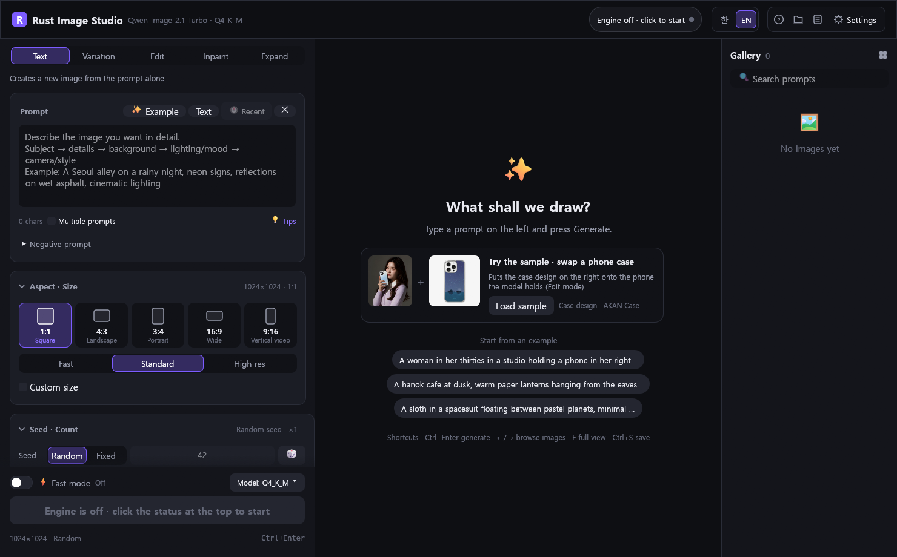
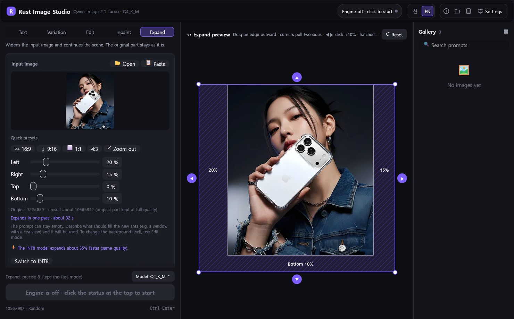

<div align="center">


# Rust Image Studio

**Run Qwen-Image-2.1 locally · an on-device AI image studio built natively in Rust**<br>
Text-to-image · img2img variation · instruction editing · inpainting · *fidelity-preserving outpainting*<br>
Qwen-Image-2.1 Turbo · fully offline inference · no account, subscription or cloud


**English** · [한국어](README.ko.md)

### ⚡ Qwen-Image-2.1, smooth on 8 GB of VRAM, and runs on 4–6 GB too
1024×1024 in **~10–19 s** on an RTX 3060 Ti 8 GB · 4–6 GB cards switch to a low-VRAM mode automatically · AMD Radeon experimental · runs locally, no high-end GPU or cloud

[-0078d4?style=for-the-badge&logo=windows&logoColor=white)](../../releases/latest/download/RustImageStudio-windows-x64.zip)
[-fcc624?style=for-the-badge&logo=linux&logoColor=black)](../../releases/latest/download/RustImageStudio-linux-x64.tar.gz)

**Prebuilt binaries** · extract the archive and run `RustImageStudio.exe`, no build step required.<br>
Engine and models are provisioned on first launch · full UI reference: **[menu guide](docs/GUIDE.md)**

[Highlights](#highlights) · [Built with Claude](#built-with-claude) · [Features](#everything-in-the-box) · [Under the hood](#under-the-hood) · [Performance](#performance)<br>
[Get started](#get-started) · [**Menu guide**](docs/GUIDE.md) · [AMD Radeon](#amd-radeon-experimental) · [Linux](#linux-experimental) · [Build](#build-from-source)



</div>

## Highlights

<table>
<tr>
<td width="25%" valign="top">

### ⚡ Fast on 8 GB
1024×1024 in **~10–19 s** on an RTX 3060 Ti 8 GB. A fixed 6 GB VRAM budget plus a resident, pre-warmed model keeps latency low, and an optional INT8 path uses the tensor cores. Cards with 4–6 GB get a smaller budget and tiled VAE decoding on their own ([table](#windows)).

</td>
<td width="25%" valign="top">

### 📦 Zero setup
A single 26 MB executable with no runtime dependencies. First launch provisions the engine, models and LoRAs (resumable). No Python, ComfyUI or node graphs.

</td>
<td width="25%" valign="top">

### 🖼️ Outpainting
Drag the edges to extend the canvas. Source pixels are recomposited at native resolution, large expansions run in multiple passes, and blank fills are detected and redrawn automatically.

</td>
<td width="25%" valign="top">

### 🦀 Native Rust
An immediate-mode GPU UI (egui) with no Electron or web view. It repaints only on state changes, and GPU jobs are scheduled one at a time to avoid VRAM contention.

</td>
</tr>
</table>

## Built with Claude

To get the most out of Rust, this project makes extensive use of Anthropic's **Claude AI** (Claude Code) in its development.

- **Memory safety and concurrency** — an ownership-driven architecture, designed together with Claude, runs downloads, image decoding and engine I/O off the UI thread without data races.
- **Zero-cost abstractions, native performance** — a single binary with no garbage collector or separate runtime, and an immediate-mode GPU UI that repaints only on state changes.
- **One codebase, two platforms** — platform-specific code is isolated with conditional compilation (`cfg`), so the same source builds for Windows and Linux.
- **Validation-first development** — major changes made with Claude were verified with unit tests, generation timings measured on real GPUs, and UI checks against in-app screen captures.

## Use case: phone-case design swap

The input is two images and a single instruction. With the model photo as reference 1 and the case design as reference 2, Edit mode replaces only the case while preserving pose, hands, face and lighting. The sample ships with the app and can be reproduced from the start screen via **Load sample**.

<p align="center"></p>

> *"Change the case of the phone in image 1 to exactly the case design in image 2. Keep the person, pose and background unchanged."*

Sample artwork courtesy of **[AKAN](https://akan.co.kr/?utm_source=github&utm_medium=readme&utm_campaign=rust-image-studio)**<br>
Rust Image Studio originated as AKAN's in-house tool for product visuals and is now open-sourced for creators and developers.

## Everything in the box

Every control, menu and option is documented in the **[menu guide](docs/GUIDE.md)**.

<table>
<tr>
<td width="33%" valign="top">

#### 🎨 Five modes
**Text** · **Variation** (img2img with strength) · **Edit** (instructions + up to 3 reference images) · **Inpaint** (brush the area) · **Expand** (outpainting). One shortcut each (Ctrl+1…5); the mode bar stays pinned while you scroll.

</td>
<td width="33%" valign="top">

#### ↔️ Smart Expand
A live preview with draggable sides and corners, quick presets (16:9, 9:16, 1:1, 4:3, zoom out) and per-side sliders. Equal passes are planned automatically and the source stays pixel-exact. The prompt is optional: the app writes one for you.

</td>
<td width="33%" valign="top">

#### 🧠 Auto scene prompts
Images made by the app carry their prompt in PNG metadata. For any other photo, a local vision model (Qwen3-VL via llama.cpp, on the GPU) describes the scene in ~20 s. It runs only when the image engine is idle.

</td>
</tr>
<tr>
<td valign="top">

#### 🧩 LoRA card
One-click downloads of tested LoRAs: **Lightning 4-step**, **Edit consistency** and **Multiple angles**, the last with a 12-direction × 4-height camera dial that writes the prompt for you. Incompatible combinations switch each other off.

</td>
<td valign="top">

#### 🗂️ Smart gallery
Prompt search, small and large grids, and a full-screen viewer with zoom and pan. Every PNG embeds its seed, size, mode and prompt, so dropping it back in restores the exact settings. Deletions go to the Recycle Bin / Trash.

</td>
<td valign="top">

#### ✍️ Text in images
Renders legible signage text, including Hangul. A one-click text template, validated prompt tips and per-mode examples are built in.

</td>
</tr>
<tr>
<td valign="top">

#### 🧵 Workflow essentials
A job queue that accepts work while generating, batch prompts (one per line), multi-image runs, fixed or random seeds, clipboard paste and copy, drag and drop anywhere, and Save as PNG/WebP/JPG.

</td>
<td valign="top">

#### 🌏 Bilingual UI
Korean and English, switchable live from the top bar. Prompts perform equally well in either language.

</td>
<td valign="top">

#### 🛡️ Responsible by default
A built-in guard refuses prompts that sexualize minors. Everything else stays on your machine, with no telemetry and no uploads.

</td>
</tr>
</table>

<p align="center"></p>



## Under the hood

Engineering notes. Every figure below was measured in the app on an RTX 3060 Ti 8 GB with 16 GB RAM.

- **Resident, pinned engine.** stable-diffusion.cpp's `sd-server` runs as a managed child process with a fixed placement: weights mirrored in RAM and a 6 GB VRAM cap. The auto-fit placement sometimes failed, or re-read the model from SSD for every image (+6 s), depending on how much RAM was free at startup. Pinned placement gives the same speed every time.
- **Warm start.** A one-step warm-up at launch loads the weights before you click, so the first image is as fast as the tenth.
- **INT8 tensor cores.** Optional INT8 ConvRot weights take a step from **1.66 s to 1.02 s**. Same-prompt repeats drop to **~12.5 s**, or **~10.5 s** with ⚡ Fast mode (Spectrum step cache, −23% sampling).
- **Expand without seams.** The new area is generated against a grey-padded reference of the source with a 3% overlap mask. The result is enlarged up to 1.6× and the original is composited back with a smoothstep feather, so the source part is never re-encoded. Wide zooms are split into equal passes (≤3× area, ≤1.6× when three or more sides grow).
- **A blank-fill detector.** At 1/8 scale it compares the structure in the new band with the source next to it. On 28 test outputs it caught **all 8 failures with zero false alarms** (plain walls and studio backdrops pass), and a failed pass is redrawn with a new seed up to twice.
- **GPU scheduling, not GPU fighting.** The 7.5 GB photo describer only runs while the image engine is idle. A generate click made meanwhile waits for it and then starts on its own. Every child process is tied to a Windows Job Object (on Linux: `PR_SET_PDEATHSIG`), so nothing outlives the app.
- **Resumable first run.** Downloads continue across restarts with HTTP Range requests. Zips (and the Linux tarballs) are extracted to temporary names and renamed only when complete, so a cut-off install never looks finished. The app checks free disk space before it starts.
- **A small, quiet app.** Around 9.3k lines of Rust in one 26 MB exe. The UI repaints only when something changes, and thumbnails, decoding and file I/O stay off the UI thread.

## Performance

1024×1024, RTX 3060 Ti 8 GB, 16 GB RAM:

| Setup | New prompt | Same prompt again |
|---|---|---|
| Q4_K_M (default) | ~19 s | ~19 s |
| INT8 tensor cores | ~21 s | ~12.5 s |
| INT8 + ⚡ Fast mode | ~20 s | ~10.5 s |
| Expand, per pass (INT8) | ~19 s | |
| Photo description | ~18–19 s | |

## Get started

### Windows

**System requirements:** Windows 10/11 x64 · NVIDIA GPU with **8 GB+ VRAM** recommended, 4–6 GB works in an automatic low-VRAM mode (see below), and a current driver (AMD Radeon: [experimental](#amd-radeon-experimental)) · 16 GB RAM · about 15 GB of free disk space · internet access on first run. No installation step: the executable has no runtime dependencies and provisions everything else on first launch. The graphics driver is the one component the app cannot install; it reports when none is found.

**Graphics cards with 4–6 GB of VRAM** switch to a low-VRAM mode on their own (cards with 8 GB or more keep the default settings):

| VRAM | VRAM budget | VAE decode | Measured 1024×1024* |
|---|---|---|---|
| 8 GB and up | 6 GB | normal | ~18 s |
| 6 GB (GTX 1660 Ti, RTX 2060, laptop RTX 3060/4050) | 4 GB | 512² tiles | ~26 s |
| 4 GB (laptop RTX 3050, GTX 1650) | 3 GB | 512² tiles | ~28 s |

\*On an RTX 3060 Ti with the rest of its VRAM held by another program to leave what a 6 GB / 4 GB card has free. Slower cards take proportionally longer (a GTX 1650-class card perhaps 50–90 s). GeForce GTX cards have no tensor cores, so the INT8 model is hidden there and the standard Q4 model is used.

1. Download [`RustImageStudio-windows-x64.zip`](../../releases/latest/download/RustImageStudio-windows-x64.zip) (prebuilt binary, about 10 MB; all versions are on [Releases](../../releases)) and extract it into an empty folder.
2. Run `RustImageStudio.exe`. No Rust toolchain, Visual Studio or source build is required; those apply only when [building from source](#build-from-source).
3. The first launch provisions all components automatically (about 12.7 GB; downloads resume if interrupted):

| Item | Size | From |
|---|---|---|
| Visual C++ runtime, only if missing (one Windows permission prompt) | 26 MB | Microsoft |
| Generation engine: stable-diffusion.cpp, CUDA 12 (on AMD: ROCm 266 MB or Vulkan 30 MB instead) | 363 MB | GitHub |
| CUDA runtime (cudart, cuBLAS), NVIDIA only | 563 MB | GitHub |
| Qwen-Image-2.1 Turbo Q4_K_M | 4.2 GB | Hugging Face |
| Qwen3-VL-8B text encoder | 5.1 GB | Hugging Face |
| VAE | 676 MB | Hugging Face |
| *Extras:* vision module (edit, expand, photo description) | 1.2 GB | Hugging Face |
| *Extras:* 3 recommended LoRAs | 545 MB | Hugging Face |
| *Extras:* photo describer: llama.cpp, Vulkan | 38 MB | GitHub |

Extras are optional: if one fails, core generation remains available and the component can be fetched again later. The faster INT8 model (7.3 GB) can be added from the model menu.
Files go next to the exe (`runtime/`, `models/`, `outputs/`). Settings live in `%APPDATA%\Rust Image Studio`.

### AMD Radeon (experimental)

The app can run on AMD Radeon cards with stable-diffusion.cpp's **official** AMD builds of the same tag
(`master-1052-f5df5f8`); no CUDA translation layer is involved. It picks the build from the graphics card, and
**Settings → GPU** overrides the choice (Automatic · NVIDIA CUDA · AMD ROCm · Vulkan). Each build lives in its own folder
(`runtime\` for CUDA, `runtime\rocm\`, `runtime\vulkan\`), so switching back and forth doesn't re-download anything.

| GPU found | Engine picked automatically | Download |
|---|---|---|
| NVIDIA (driver present) | CUDA 12 + CUDA runtime, unchanged | 363 MB + 563 MB |
| AMD Radeon RX 6000 / 7000 / 9000, Radeon PRO W6000–W9000, Radeon 8060S/8050S/8040S (Windows) | ROCm/HIP; the zip ships the HIP runtime DLLs, so only the AMD Adrenalin driver is needed | 266 MB |
| Other AMD Radeon (RX 5000 and older, most integrated Radeon graphics) | Vulkan | 30 MB |
| AMD on Linux with `/dev/kfd`, a supported `gfx` target and ROCm 7 installed (`libamdhip64.so.7`, `libhipblas.so.3`, `librocblas.so.5`) | ROCm (Ubuntu 24.04 build, glibc 2.38+) | 298 MB |
| AMD on Linux otherwise | Vulkan (upstream builds it on Ubuntu 26.04: needs **glibc 2.43+**) | 42 MB |

The device name the engine uses (`ROCm0`, `Vulkan0`) is read from `sd-server --list-devices`, and the same placement as on
NVIDIA is used: weights mirrored in RAM, a 6 GB VRAM budget (less on cards under 8 GB). Not available off CUDA: the
**INT8 tensor-core model** (it needs the CUDA build's CUTLASS INT8 kernels; the app uses Q4_K_M there and hides the option).
⚡ Fast mode and every generation mode stay available. The photo describer was already a Vulkan build and runs on AMD
drivers too.

**Validation status.** For transparency: **none of this has been run on AMD hardware yet**. The development PC has an
RTX 3060 Ti only.

| Verified | Environment |
|---|---|
| GPU detection, backend choice, device-name parsing, the Linux ROCm zip's `build/bin/` layout, VRAM budget: unit tests | Windows |
| The NVIDIA path is unchanged: still `CUDA0`, still the CUDA runtime download, 1024×1024 in 18.3 s / 19.5 s, all tests pass | Windows, RTX 3060 Ti |
| Archive contents and dependencies of the four AMD zips (HIP DLLs bundled on Windows; Linux ROCm links system ROCm 7; Linux Vulkan glibc floor 2.43) | read from the published archives |
| **The Vulkan engine path end to end in the app**: device read as `Vulkan0`, Q4_K_M generation at 1024×1024 in 21.5 s (new prompt) / 19.1 s (repeat), ⚡ Fast mode 15.1–15.8 s; the first launch's warm-up took 83 s (shader compilation), later ones 22 s | Windows, upstream Vulkan zip on the **RTX 3060 Ti** (NVIDIA's Vulkan driver, not AMD's) |
| First-run setup with the Vulkan engine from a local mirror: no CUDA runtime in the list, the zip unpacked into `runtime\vulkan\`, the GPU line and a failed download shown on the setup screen | Windows |

| Not yet verified | Reason |
|---|---|
| Any generation on an AMD Radeon, with either the ROCm or the Vulkan build, and its speed or VRAM behaviour | no AMD GPU available |
| That the Windows ROCm build works with a given Adrenalin driver version, and the RX 6000/7000/9000 name heuristic for picking it | needs AMD hardware |
| Linux ROCm with a real ROCm 7 install; the Linux Vulkan build on Ubuntu 26.04 | needs AMD hardware / a 26.04 system |

If the chosen engine finds no GPU, the app says so and suggests another option in Settings → GPU (for example Vulkan instead
of ROCm). Reports from Radeon owners (card, driver, which engine, seconds per image, or the engine log) are very welcome.

### Linux (experimental)

The deployment model matches Windows: a single executable that provisions everything else on first launch. stable-diffusion.cpp publishes
no Linux CUDA build, so this repository builds one (`scripts/build-linux-engine.sh`, run by the
[`linux-engine`](.github/workflows/linux-engine.yml) workflow: the same tag and options as upstream's Windows CUDA build, CUDA 12.8,
GPU architectures from Pascal to Blackwell) and publishes it, together with the CUDA runtime libraries, as the release
`engine-sd-master-1052-f5df5f8`.

> **Linux engine release:** the app downloads the engine from this repository's `engine-sd-master-1052-f5df5f8` release,
> which is published by running the `linux-engine` workflow once. Until it exists, the engine download fails and the setup
> screen offers the build-it-yourself commands instead.

**System requirements:** x86_64 Linux with glibc 2.35+ (Ubuntu 22.04, Debian 12 or newer) · NVIDIA GPU with 8 GB+ VRAM recommended (4–6 GB use the low-VRAM mode) and the proprietary
driver (525 or newer; the app warns if it finds none) · 16 GB RAM · about 17 GB free disk · an X11 or Wayland desktop.

| Downloaded on first launch | Size | From |
|---|---|---|
| Generation engine: stable-diffusion.cpp, CUDA 12 (Linux build) | ~360 MB (estimate) | this repository's engine release |
| CUDA runtime (cudart, cuBLAS) | 594 MB | this repository's engine release |
| Models, extras, LoRAs | as on Windows | Hugging Face |
| *Extras:* photo describer: llama.cpp `b12182`, Ubuntu Vulkan | 36 MB | GitHub (ggml-org/llama.cpp) |

System libraries outside the scope of provisioning come from your distribution; most desktops already include them:

```bash
sudo apt install libxkbcommon0 libxkbcommon-x11-0 libwayland-client0 libx11-6 libxcursor1 libxrandr2 libxi6 libvulkan1 libgl1 libegl1 xdg-desktop-portal
```

The setup screen checks the parts it can (the NVIDIA driver, glibc, `libstdc++`, `libvulkan` for the photo describer) and names the package to install.
`libxkbcommon-x11-0` is required on X11 sessions; without it the app exits before opening a window. `xdg-desktop-portal` plus a GTK, GNOME or KDE
backend provides the file dialogs. The Korean font (Nanum Gothic) and the icon fonts are built in. If the window doesn't open, try
`WGPU_BACKEND=vulkan ./RustImageStudio` (or `=gl`).

1. Download [`RustImageStudio-linux-x64.tar.gz`](../../releases/latest/download/RustImageStudio-linux-x64.tar.gz) (prebuilt binary; all versions are on [Releases](../../releases)) and extract it: `tar xzf RustImageStudio-linux-x64.tar.gz`.
2. Run `./RustImageStudio/RustImageStudio`. The first launch provisions the engine, the CUDA runtime, the models and the extras
   (resumable), then starts the engine.

Settings live in `~/.local/share/rustimagestudio`. A self-built `sd-server` in `runtime/` or on your `PATH` is used instead of the
download (the setup screen shows the build commands if the engine download fails).

**Linux validation status.** For transparency: this port has **not** been run on a real (non-WSL) Linux desktop,
and **the Linux engine release has not been built by CI or published yet**; the engine below was built locally.

| Verified | Environment |
|---|---|
| `cargo check`, `cargo test` (26 tests) and `cargo build --release` pass without warnings; the binary links only to glibc and libgcc_s | Ubuntu 24.04 under WSL2, no `-dev` packages installed |
| `.tar.gz` extraction: top-folder strip, symlinks, exec bits, unsafe paths skipped | unit tests, on Linux and Windows |
| `scripts/build-linux-engine.sh` with CUDA 12.8 builds and packages both archives; outside them the engine needs only glibc, `libstdc++`, `libgcc` and the driver's `libcuda.so.1` | WSL2, one GPU architecture (sm_86), so a 68 MB engine archive instead of the full one |
| First-run setup end to end from a local mirror: the app downloads and unpacks that engine, the CUDA runtime and the real llama.cpp `b12182` tarball (exec bits set, the CUDA libraries found next to `sd-server` through `RUNPATH=$ORIGIN`) | WSL2 |
| The app starting that engine on an RTX 3060 Ti and generating a 1024×1024 image (24 s); `sd-cli` from the same build, 512×512 | WSL2 (CUDA through the Windows driver) |
| The engine dying with the app, also on `kill -9` (`PR_SET_PDEATHSIG`) | WSL2 |
| The app window, setup screen and main screen in English and Korean, built-in Korean and icon fonts (no missing glyphs) | WSLg (Wayland; `WGPU_BACKEND=vulkan` was needed there) |

| Not yet verified | Reason |
|---|---|
| The `linux-engine` workflow on GitHub (all nine architectures, a few hours), its glibc floor (the local build on 24.04 needs 2.38; the workflow builds on 22.04 for 2.35) and the published engine archive's real size | the workflow has not been run yet |
| The NVIDIA driver / glibc / libvulkan notices on the setup screen | compiled for Linux, not seen on a machine that lacks them |
| The photo describer on the NVIDIA Vulkan driver under Linux | needs a native driver |
| File dialogs, clipboard, Trash and "show in folder" on a real GNOME/KDE desktop | WSLg has no desktop portal or file manager |
| Linux performance (every number on this page is from Windows) | WSL2 numbers aren't representative |

Known issue (WSLg): intermittently (observed while the engine loads) the window opens at 640×480 and WSLg ignores the resize
request; resize it manually. Not observed on Windows; untested on native Linux desktops.

Feedback from native Linux installations is highly appreciated.

## Prompting tips

- Describe **subject → details → background → lighting/mood → camera or art style**. Descriptive prompts outperform single keywords.
- For text, name the object first and quote the words: `a wooden sign with the words "HAPPY DAY" written in large letters`.
- For edits, say what to change **and** what to keep: `Change the background to a beach. Keep the person unchanged.`
- **✨ Example** and **💡 Tips** in the prompt card provide more guidance for every mode.

**Shortcuts:** F1 help · Ctrl+Enter generate · Ctrl+1…5 modes · ←/→ browse · F full view · Ctrl+S save as · Ctrl+Shift+C copy · Ctrl+V paste input · Del delete · Esc close

## Build from source

Windows requirements: Visual Studio Build Tools ("Desktop development with C++") and Rust (rustup, MSVC toolchain).
Linux requirements: Rust (rustup) and a C toolchain (`build-essential`). No `-dev` packages are needed: the windowing,
GL/Vulkan and clipboard libraries are loaded at run time, and the file dialogs go through the XDG desktop portal.

```
git clone <this repository>
cd rust-image-studio
build              # Windows: cargo build --release, then copies the exe to RustImageStudio.exe
cargo build --release   # Linux: target/release/rust-image-studio
cargo test         # unit tests, no GPU needed
```

Pushing a tag like `v1.0.0` makes GitHub Actions build Windows and Linux packages and attach them to a release.
The Linux engine is a separate, slow workflow (`linux-engine`, run by hand or by pushing `engine-sd-master-1052-f5df5f8`); it publishes the release the app's Linux engine download points to.

## Content safety

The guard against sexual content involving minors is part of the app. Please don't open issues or pull
requests that try to weaken it. You are responsible for what you generate and for following the model licenses.

## License

App source code: [MIT](LICENSE). Models, engines and LoRAs keep their own licenses. The Qwen-Image models use the
Qwen license, so check it before any commercial use. See [THIRD_PARTY_NOTICES.md](THIRD_PARTY_NOTICES.md).

*The application is written in Rust. The inference itself runs in stable-diffusion.cpp and llama.cpp (C/C++, CUDA/Vulkan), which the app downloads and drives.*
Not affiliated with Alibaba/Qwen, stable-diffusion.cpp or llama.cpp.
